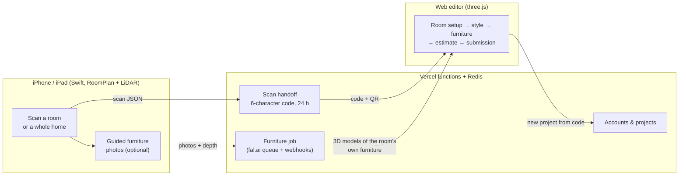

# RoomMuse — case study

**Scan a room with an iPhone, open it on any computer, and furnish it in 3D.** I'm a founding software engineer at [RoomMuse Studio](https://roommusestudio.com) (Jun 2026–present) and the largest contributor to the product's main repository. Our first customer signed on a **$55k contract**. This page describes the system and the parts I built.

*The source is private. This write-up is published with my co-founders' agreement and contains no proprietary code.*

## How it works

A customer scans the room with the iPhone app and gets a short code (or scans a QR code shown on the website). They type it on a laptop, and the exact room appears in the editor, with its walls, doors, windows and sockets. From there they furnish it and get a price estimate. Every change saves to their project as they work.

## What I built

### 1. The scan handoff, in production

- Moved the phone-to-laptop handoff onto **Vercel serverless functions with Redis**, so every instance sees the same codes and they survive redeploys.
- **Codes are claimed atomically** (`SET … NX EX`): two uploads can never get the same code, and each one expires after 24 hours. Codes come from a 29-character alphabet with lookalikes removed (no 0/O, 1/I/L, U).
- **Abuse limits:** uploads and code lookups are rate-limited per network, so codes can't be guessed by brute force.
- **QR flow:** a new project starts with a QR code that opens the scanner app directly.

### 2. Accounts and projects

- **Sign-in tokens verified without an SDK:** Firebase ID tokens are checked by hand with `node:crypto` (RS256 signatures against Google's rotating certificates). Our server then issues its own opaque, revocable `HttpOnly` session cookie.
- **Projects are private by construction:** any account that isn't the owner gets a 404 on every route, so project IDs can't be probed.
- **No silent overwrites:** every save carries the revision the editor loaded. A stale tab or second device gets a `409` and is asked to reload, instead of overwriting newer work.

### 3. "Your furniture": the room's own furniture as editable 3D models

Customers want to see their existing sofa next to the new pieces. So the room's real furniture is rebuilt in 3D from photos:

- **Guided capture (iOS):** after a scan, the app outlines each detected piece live over the camera and takes the photo automatically. It waits until the whole piece is in frame, nothing blocks it (checked with LiDAR depth), and the phone is steady. Up to two angles per piece; the customer can also tap things RoomPlan missed.
- **Server pipeline:** correct camera poses with LiDAR depth → SAM 3 mask per object → SAM 3D model → fit the model into the piece's measured box. Each step runs asynchronously on fal.ai's queue and resumes on its webhook.
- **Room finishes:** the same photos give the room's wall, floor and door colours, so the editor can dress the scan like the real room.

### 4. Choosing the model with data, not demos

Before shipping, I built an **ablation harness** to decide which 3D generator to use. It compared Meta's SAM 3D, TRELLIS.2, Hunyuan 3D, Tripo multi-view and a catalogue-match baseline.

- Every model is scored on **photos it never saw**: the three views least like the input are held out.
- Models are rendered **through the editor's own three.js renderer**, then compared to the photo by outline IoU, colour difference (ΔE) and structural similarity (SSIM). The score is what a customer would actually see.
- A **budget guard** caps spend at $10 per room, and every mask and model is cached, so reruns cost nothing.
- Plain SAM 3D won on two real rooms and is what runs in production. The finding that mattered most: capture quality limited results more than the choice of model, which is why the guided capture above exists.

### 5. The scanner app (Swift)

I redesigned the iOS scanner to match the web app. It covers single rooms and whole homes (several rooms uploaded as one scan, in their real positions). There's a debug-only demo mode for simulator screenshots.

## Engineering

- **140 automated tests** run on every push: storage, handoff, auth, projects, rate limits, scan-to-room conversion, the furniture job and a browser test of the editor. Firebase, Redis and Supabase are replaced by local fakes, so tests need no accounts or network.
- **One API, two hosts:** the same handlers run as Vercel functions in production and as a plain Node server locally.

| Layer | Stack |
|---|---|
| Scanner | Swift, SwiftUI, RoomPlan, ARKit (LiDAR depth) |
| Server | Node.js on Vercel functions, Redis (Upstash), Vercel Blob / Supabase Storage, Firebase Auth |
| ML | SAM 3 (segmentation), SAM 3D (image-to-3D), via fal.ai |
| Editor | three.js, React (no build step) |
